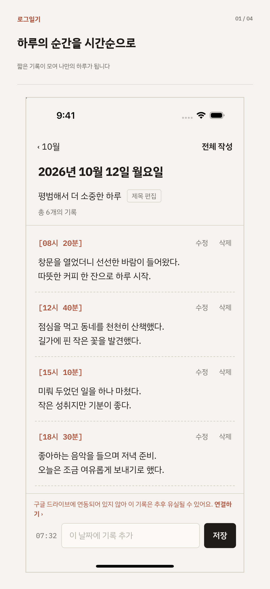
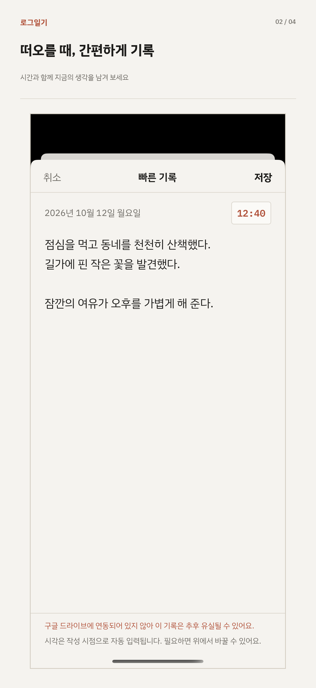
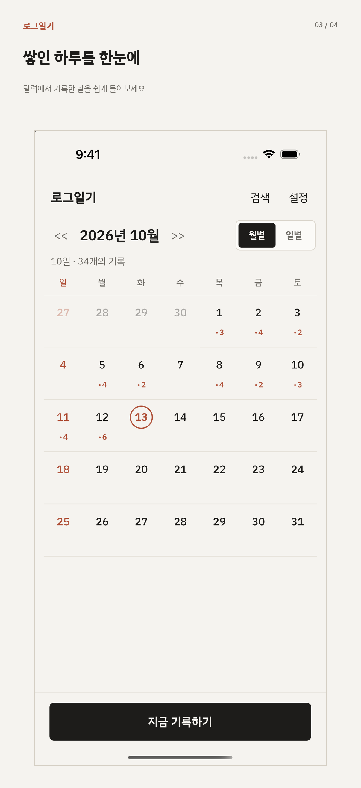
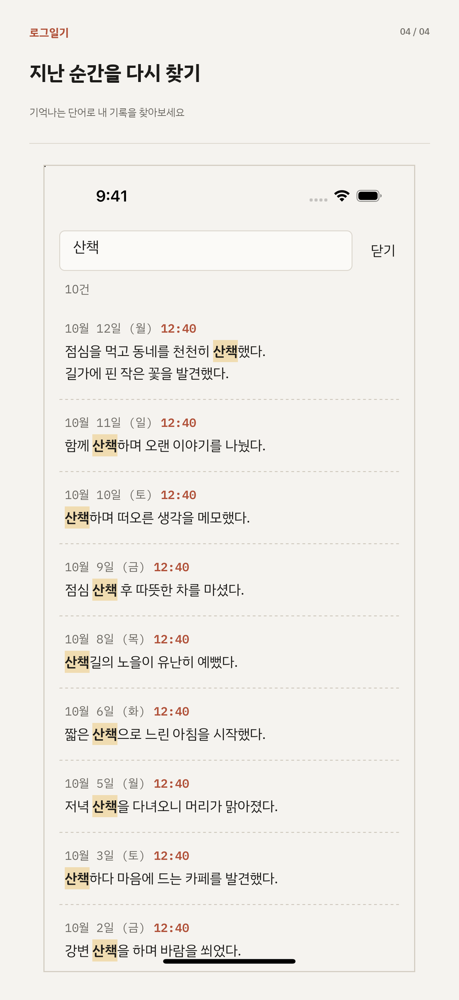

  

  떠오른 생각을 시각과 함께 바로 남기는 타임라인 일기 앱

## 목차

- [소개](#소개)
- [화면](#화면)
- [주요 기능](#주요-기능)
- [기록 보관](#기록-보관)
- [안내 및 문의](#안내-및-문의)
- [개발](#개발)
- [License](#license)

## 소개

로그일기는 긴 일기 대신, 순간순간 떠오른 생각을 한 줄씩 남기는 일기 앱입니다. 하루의 기록이 시간순으로 쌓이고, 월별 달력과 검색으로 지난 기록을 다시 찾아볼 수 있습니다.

## 화면

  
  
  
  

## 주요 기능

- **하루 타임라인** : 그날 남긴 기록이 시간순으로 쌓입니다
- **빠른 기록** : 시각과 함께 생각을 바로 적습니다
- **월별 달력** : 기록한 날과 기록 수를 한눈에 보고, 날짜를 누르면 그날의 기록으로 갑니다
- **검색** : 기록 내용으로 지난 기록을 찾습니다
- **앱을 열지 않고 기록**
  - **iPhone · iPad** : 잠금화면 위젯 「일기 바로 작성」
  - **Android** : 알림 패널 상시 표시의 「일기 바로 작성」
- **텍스트로 내보내기** : 이번 달 또는 전체 기록을 `.txt` 파일로 저장하거나 공유합니다

## 기록 보관

- 기록은 **사용 중인 기기 안에** 저장됩니다. 로그일기는 별도의 서버를 운영하지 않으며, 작성한 기록을 개발자가 볼 수 없습니다.
- Google 계정을 연결하면 **Google 드라이브의 앱 전용 숨김 폴더**에 백업합니다. (매일 자동 · 기록이 바뀔 때마다 · 지금 백업)
- 새 기기에서 같은 계정을 연결하고 「백업에서 가져오기」를 누르면, 기기의 기록을 지우지 않고 백업과 합칩니다.

## 안내 및 문의

- [개인정보처리방침](https://wisdomstar94.github.io/log-diary/privacy/)
- [고객지원 · 자주 묻는 질문](https://wisdomstar94.github.io/log-diary/support/)
- **이메일** : [wisdomstar94@gmail.com](mailto:wisdomstar94@gmail.com)

## 개발

Expo(React Native) 앱과 정책 페이지를 담은 npm workspaces 모노레포입니다. 설치 · 환경 설정 · 실행 · 빌드 방법은 [docs/DEVELOPMENT.md](docs/DEVELOPMENT.md) 를 참고하세요.

## License

[LICENSE](LICENSE)
